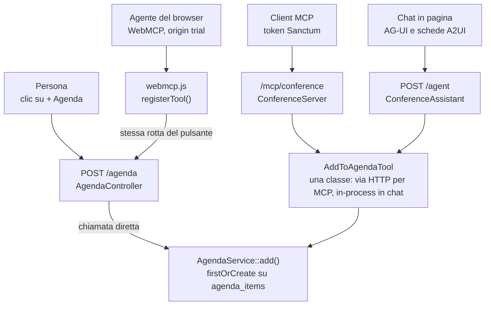

# Apri la tua app agli agenti: MCP, AG-UI e A2UI

Demo del talk presentato al [LaravelDay 2026](https://laravelday.it).

> L'interazione con le nostre applicazioni sta cambiando radicalmente con l'arrivo dell'IA e degli agenti. Fino a ieri c'era solo l'interfaccia web; oggi un agente può usare la nostra app come strumento, dialogare con noi al suo interno e perfino disegnarne l'interfaccia.
>
> In questo talk vediamo come offrire nuovi punti di accesso a un'applicazione Laravel esistente, partendo dalla logica che già abbiamo e senza riscriverla. Con MCP la rendiamo utilizzabile da Claude, Cursor e dagli altri client compatibili. Con AG-UI portiamo un agente dentro l'app, in streaming, mantenendo il controllo sulle azioni che contano. Con A2UI lasciamo che sia l'agente a comporre l'interfaccia, mentre l'app decide come mostrarla.
>
> Un percorso pratico tra protocolli, codice e demo dal vivo, con uno sguardo finale a WebMCP e agli agenti che arrivano direttamente nel browser.

## In breve

La demo è un'app Laravel 13 con il programma di una conferenza: talk, agenda personale, prenotazione workshop. Mostra che la stessa logica applicativa può essere raggiunta da un essere umano, da un client MCP, da un agente in chat e dall'agente del browser, senza riscriverla.

Il filo del talk è una sola azione, `add_to_agenda`. Vive in `AgendaService::add()` e ogni "porta" la chiama a modo suo.

Stato al 12 novembre 2026: i 43 test Pest passano, gli asset compilano e la chat è stata provata nel browser con un modello OpenAI vero (schede A2UI, aggiunta all'agenda dalle schede, grafici).

| Pezzo | Libreria | Versione |
| --- | --- | --- |
| Framework | Laravel, PHP | 13.42, 8.5 |
| Server MCP | `laravel/mcp` | 1.1 |
| Agente e AG-UI lato server | `laravel/ai` | 1.3 |
| Client AG-UI | `@ag-ui/client` | 1.0.4 |
| Rendering A2UI | `@a2ui/web_core`, `@a2ui/lit`, `@a2ui/markdown-it` | 0.15 (spec 1.0), 0.2 |
| Auth MCP | Laravel Sanctum | token personali |
| Database, test, CSS | SQLite, Pest 5, Tailwind 4 | |

## Architettura

Quattro chiamanti diversi arrivano alla stessa riga di codice, `AgendaService::add()`.



Il server MCP e l'agente in chat condividono la stessa classe tool. Il tool WebMCP non ne ha una sua: chiama la rotta web già usata dal pulsante. Lo stesso schema vale per `book_workshop` e `WorkshopBookingService::book()`.

## Dominio e servizi

Tutta la logica sta in due service class; controller, tool MCP e agente si limitano a chiamarle.

| Modello | Campi principali | Note |
| --- | --- | --- |
| `Speaker` | name, company, bio | |
| `Talk` | title, abstract, track, room, starts_at, ends_at | `track` è castato all'enum `App\Enums\Track` |
| `Workshop` | title, description, capacity, starts_at, ends_at | `seatsLeft()` calcola i posti liberi |
| `AgendaItem` | user_id, talk_id | coppia unica |
| `WorkshopBooking` | user_id, workshop_id | coppia unica |

L'enum `Track` ha cinque casi: Ai, Backend, Frontend, DevOps, Community.

| Service | Metodi | Comportamento |
| --- | --- | --- |
| `AgendaService` | `searchTalks`, `talksFor`, `add`, `remove`, `clear` | `add` usa `firstOrCreate`, quindi è idempotente |
| `WorkshopBookingService` | `workshops`, `book` | `book` gira in transazione, è idempotente e lancia `ValidationException` se il workshop è al completo |
| `A2uiSurfaceBuilder` | `talkCards`, `workshopCards`, `barChart` | costruisce i messaggi A2UI, vedi sotto |

`ConferenceSeeder` carica 11 talk e 3 workshop inventati, datati 26 novembre 2026. Il terzo workshop ha capienza 2, per mostrare dal vivo l'errore "al completo". I dati vanno sostituiti con il programma vero.

## Server MCP

`ConferenceServer` espone sei tool e una resource su `/mcp/conference`, protetti da un token Sanctum. La registrazione è una riga in `routes/ai.php`:

```php
Mcp::web('/mcp/conference', ConferenceServer::class)->middleware('auth:sanctum');
```

| Tool | Cosa fa | Annotazione |
| --- | --- | --- |
| `search_talks` | cerca talk per testo e track, risposta strutturata | read-only |
| `show_agenda` | elenca l'agenda dell'utente | read-only |
| `add_to_agenda` | aggiunge un talk all'agenda | idempotente |
| `clear_agenda` | svuota l'agenda | distruttiva |
| `list_workshops` | elenca i workshop con i posti rimasti | read-only |
| `book_workshop` | prenota un posto, con ruolo in azienda (`App\Enums\CompanyRole`) e nome azienda | restituisce `Response::error` se al completo |

La resource `conference://schedule` restituisce l'intero programma.

Un tool è una classe con attributi, validazione e una chiamata al service. Questo è `AddToAgendaTool`:

```php
#[Name('add_to_agenda')]
#[Description("Aggiunge un talk all'agenda personale dell'utente. Usa search_talks per trovare l'id del talk.")]
#[IsIdempotent]
class AddToAgendaTool extends Tool
{
    public function handle(Request $request, AgendaService $agenda): Response
    {
        $validated = $request->validate([
            'talk_id' => ['required', 'integer', 'exists:talks,id'],
        ]);

        $talk = Talk::find($validated['talk_id']);

        $agenda->add($request->user(), $talk);

        return Response::text("\"{$talk->title}\" aggiunto all'agenda ({$talk->starts_at->format('H:i')}, {$talk->room}).");
    }
}
```

L'utente arriva da `$request->user()`, cioè dal token: ogni client MCP agisce per conto di una persona precisa.

Per collegare un client serve un token, da passare come header `Authorization: Bearer <token>`:

```bash
php artisan tinker --execute 'echo App\Models\User::first()->createToken("mcp")->plainTextToken;'
```

Senza token il server risponde 401. Per ottenerlo `mcp/*` è stato aggiunto a `shouldRenderJsonWhen` in `bootstrap/app.php`; senza quella riga Laravel rispondeva con un redirect 302 alla pagina di login.

## Agente e AG-UI

`ConferenceAssistant` è un agente `laravel/ai` che riusa le stesse classi tool del server MCP, eseguite in-process, senza passare da HTTP. È il punto centrale del talk: i tool si scrivono una volta sola.

```php
public function tools(): iterable
{
    return [
        new SearchTalksTool,
        new ShowAgendaTool,
        new AddToAgendaTool,
        new ListWorkshopsTool,
        (new McpServerTool(new BookWorkshopTool))->requireApproval('La prenotazione occupa uno dei posti limitati del workshop.'),
        (new McpServerTool(new ClearAgendaTool))->requireApproval("Tutti i talk verranno rimossi dall'agenda."),
        app(ShowTalkCards::class),
        app(ShowWorkshopCards::class),
    ];
}
```

L'agente ha un limite di 8 passi (`#[MaxSteps(8)]`) e istruzioni in italiano. Non fissa un modello: usa il default di `laravel/ai` per il provider configurato, che ora è OpenAI.

L'endpoint AG-UI è `POST /agent`, un controller di poche righe:

```php
$chat = AgentUserInteraction::chat($request);

abort_if($chat->message() === null && $chat->decisions() === null, 422, '...');

return (new ConferenceAssistant)
    ->withMessages($chat->history())
    ->stream($chat)
    ->usingProtocol($chat->protocol());
```

La cronologia la possiede il client: viene rimandata a ogni run, per questo c'è `withMessages($chat->history())`. Il server non salva conversazioni.

### Approvazioni

`book_workshop` e `clear_agenda` richiedono conferma umana. Il giro è questo:

1. Il modello decide di chiamare `book_workshop`.
2. `laravel/ai` non esegue il tool e chiude il run con un interrupt dentro `RUN_FINISHED`.
3. Il client mostra una card con il motivo e i pulsanti Approva e Rifiuta.
4. Il client rilancia il run con `resume`, che porta la decisione e l'id dell'interrupt.
5. Il server esegue il tool, se approvato, e il modello conclude la risposta.

`add_to_agenda` non richiede approvazione: è idempotente e si annulla con un clic.

## A2UI

Le schede dei talk e i grafici in chat sono interfaccia dichiarativa A2UI 1.0: il server manda JSON, il browser lo trasforma in componenti. Il modello sceglie cosa mostrare; il JSON lo costruisce PHP.

1. Il modello chiama `show_talk_cards` con gli id trovati da `search_talks` (oppure `show_workshop_cards` o `show_chart`).
2. Il tool chiede i messaggi ad `A2uiSurfaceBuilder` e li restituisce come `{"a2ui": [...]}`.
3. Il risultato viaggia nell'evento AG-UI `TOOL_CALL_RESULT`.
4. `chat.js` riconosce il nome del tool e passa i messaggi al `MessageProcessor` di `@a2ui/web_core/v1_0`.
5. Un elemento `<a2ui-surface>` di `@a2ui/lit` disegna i componenti dentro la chat.

Con la 1.0 basta un solo messaggio: `createSurface` dichiara superficie e catalogo e porta i componenti in forma piatta. Ogni scheda è un `Card` con dentro un `Column`; orario e badge della track stanno in un `Row`:

```php
['id' => $key, 'component' => 'Card', 'child' => "{$key}_content"],
['id' => "{$key}_content", 'component' => 'Column', 'children' => [...]],
['id' => "{$key}_title", 'component' => 'Text', 'text' => "#### {$title}"],
['id' => "{$key}_meta", 'component' => 'Row', 'justify' => 'spaceBetween', 'children' => [...]],
['id' => "{$key}_button", 'component' => 'Button', 'variant' => 'primary',
    'child' => "{$key}_button_label", 'action' => ['event' => $action]],
```

Differenze dalla v0.9 di cui tenere conto:

- gli id dei componenti devono essere identificatori validi (UAX #31): `talk_2_title`, non `talk-2-title`;
- `Text` ha solo le varianti `body` e `caption`: il titolo è un heading Markdown, renderizzato da `@a2ui/markdown-it`;
- `@a2ui/lit` 0.15 non ha ancora un export `v1`: processor e catalogo base arrivano da `@a2ui/web_core/v1_0`, da `@a2ui/lit` serve solo l'elemento `<a2ui-surface>`.

Il pulsante emette l'evento `add_to_agenda` con `talk_id`. Il client lo riceve e chiama direttamente la rotta Laravel `POST /agenda`, senza ripassare dal modello: nessuna attesa e nessun costo.

### Un form: la prenotazione di un workshop

Per prenotare servono il ruolo in azienda e il nome dell'azienda, in tutti e tre i canali:

- **pagina web**: ogni workshop ha un `<select>` per il ruolo e un campo per l'azienda, validati da `StoreWorkshopBookingRequest`;
- **MCP e chat**: `book_workshop` li ha nello schema (il ruolo come `enum`). In chat, se l'utente non li ha detti, l'agente mostra il modulo con `show_booking_form` invece di chiederli a testo;
- **A2UI**: il pulsante della scheda apre un `Modal` con un `ChoicePicker` (il ruolo) e un `TextField` (l'azienda).

Nel form A2UI i campi sono legati al `dataModel` della surface con `{"@path": "/workshop_3/company_name"}`. Il pulsante di conferma ha due `checks` con la funzione `required`: il renderer lo tiene disabilitato finché non sono compilati. Al clic l'evento `book_workshop` porta nel `context` i valori letti da quegli stessi path, e il client li invia a `POST /workshops/{id}/bookings`.

### Catalogo custom: il grafico a barre

Il catalogo base non ha grafici. `resources/js/a2ui/conference-catalog.js` definisce un componente `BarChart` (un elemento Lit, barre in CSS senza librerie) e lo aggiunge al catalogo base con `basicCatalog.derive()`, sotto l'id `urn:laravelday:a2ui:conference`. Il tool `show_chart` mostra i partecipanti per workshop o quante persone hanno messo in agenda ogni talk (`App\Enums\ChartSubject`).

I quattro tool A2UI (`show_talk_cards`, `show_workshop_cards`, `show_booking_form`, `show_chart`) esistono solo per l'agente e non sono esposti dal server MCP.

Far generare i componenti al modello sarebbe più vicino allo spirito di A2UI, ma meno affidabile in una demo dal vivo.

## Frontend

Il frontend è Blade con pochi file JavaScript, senza React. La pagina `/` (`schedule.blade.php`) mostra l'elenco dei talk, i workshop, l'agenda e la chat.

| File | Ruolo |
| --- | --- |
| `resources/js/chat.js` | client AG-UI: bolle di testo, note sui tool, schede A2UI, card di approvazione, modalità a tutto schermo |
| `resources/js/a2ui/conference-catalog.js` | catalogo A2UI custom con il componente `BarChart` |
| `resources/js/live-regions.js` | ricarica via fetch le zone `data-live-region` (agenda e workshop), più gli helper `postJson` e `csrfToken` |
| `resources/js/webmcp.js` | registrazione del tool WebMCP |

`chat.js` usa `HttpAgent` di `@ag-ui/client` e si iscrive agli eventi dello stream:

| Evento AG-UI | Cosa fa il client |
| --- | --- |
| `TEXT_MESSAGE_START`, `TEXT_MESSAGE_CONTENT` | apre una bolla e ci accoda il testo |
| `TOOL_CALL_START` | scrive una nota con il nome del tool |
| `TOOL_CALL_RESULT` | disegna le schede A2UI, oppure ricarica agenda e workshop se il tool modifica dati |
| `RUN_FINISHED` con interrupt | mostra la card di approvazione |
| `RUN_ERROR` | mostra l'errore |

Sotto la chat c'è un pannello richiudibile "Eventi AG-UI" che elenca ogni evento ricevuto. Serve in sala per far vedere il protocollo mentre scorre. Il pulsante nell'intestazione apre la chat a tutto schermo (si chiude con Esc), comodo sul proiettore.

| Rotta | Scopo |
| --- | --- |
| `GET /login`, `POST /login`, `POST /logout` | autenticazione a sessione |
| `GET /` | programma |
| `POST /agenda`, `DELETE /agenda/{talk}` | aggiunge o toglie un talk |
| `DELETE /agenda` | svuota l'agenda |
| `POST /workshops/{workshop}/bookings` | prenota un workshop |
| `POST /agent` | endpoint AG-UI |

## WebMCP

WebMCP è solo un accenno finale: la pagina stessa dichiara un tool all'agente del browser. Lo snippet in `resources/js/webmcp.js` registra `add_to_agenda` e chiama la stessa rotta del pulsante "+ Agenda", con la sessione dell'utente.

```js
const modelContext = document.modelContext ?? navigator.modelContext;

modelContext.registerTool({
    name: 'add_to_agenda',
    description: "Aggiunge un talk all'agenda personale dell'utente loggato. ...",
    inputSchema: {
        type: 'object',
        properties: { talk_id: { type: 'integer', description: 'Id del talk da aggiungere.' } },
        required: ['talk_id'],
    },
    async execute({ talk_id }) {
        const message = await postJson(chat.dataset.agendaUrl, { talk_id });

        return { content: [{ type: 'text', text: message }] };
    },
});
```

Il codice si attiva solo se il browser espone l'API, quindi negli altri browser non fa nulla. WebMCP è in origin trial su Chrome dalla 149 alla 156. Durante il trial l'API è passata da `navigator.modelContext` a `document.modelContext`; le fonti non concordano, per questo lo snippet prova entrambe.

`laravel/mcp` ha un ramo non rilasciato, `dev-web-mcp`, con il supporto a WebMCP. La demo non lo usa.

## Avvio e configurazione

Serve PHP 8.5 e Node. Dopo il clone:

1. Lancia `composer run setup`: installa le dipendenze, crea `.env` da `.env.example`, genera la chiave, esegue le migrazioni e compila gli asset.
2. Carica i dati della conferenza con `php artisan db:seed`.
3. Apri `.env` e compila `OPENAI_API_KEY=`. `AI_PROVIDER=openai` è già impostato.
4. Lancia `composer run dev`, che avvia server PHP e Vite insieme.
5. Apri l'app e accedi con `test@example.com` e password `password`.
6. Per il client MCP genera un token con il comando della sezione Server MCP.

Per riportare i dati allo stato iniziale:

```bash
php artisan migrate:fresh --seed
```

Il provider si cambia con la variabile `AI_PROVIDER`; i provider disponibili sono elencati in `config/ai.php`. Nessun file dell'agente dipende da OpenAI.

## Test e verifiche

I 43 test Pest passano (203 asserzioni). Nei test l'agente usa il gateway finto di `laravel/ai`; il modello vero è stato provato a mano nel browser.

| File di test | Test | Copre |
| --- | --- | --- |
| `tests/Feature/Mcp/ConferenceServerTest.php` | 11 | i sei tool, la resource, l'errore "al completo" |
| `tests/Feature/AgentTest.php` | 7 | auth, 422 senza messaggio, eventi di testo, risultato A2UI, interrupt di approvazione, payload di ripresa accettato |
| `tests/Feature/ScheduleTest.php` | 6 | pagina programma, agenda, prenotazioni |
| `tests/Feature/AuthTest.php` | 3 | login e logout |
| `tests/Feature/A2uiSurfaceBuilderTest.php` | 3 | `Row` con badge della track, schede workshop, id validi per A2UI 1.0 |
| `tests/Feature/ShowChartTest.php` | 3 | dati dei due grafici, soggetto non valido |
| `tests/Feature/AgUiHistoryTest.php` | 2 | ricostruzione del `call_id` dei tool nella cronologia AG-UI, anche per la chiamata in attesa di approvazione |
| `tests/Feature/ShowBookingFormTest.php` | 2 | modulo di prenotazione A2UI mostrato dall'agente |

Si lanciano con `php artisan test --compact`.

| Pezzo | Come è stato verificato |
| --- | --- |
| Server MCP | test Pest e chiamate reali con curl e token: initialize, lista tool, `search_talks`, `add_to_agenda`, 401 senza token |
| Endpoint AG-UI | test Pest con gateway finto, più conversazioni a più turni con OpenAI |
| Chat nel browser | provata con OpenAI: schede talk e workshop, aggiunta all'agenda dalle schede, grafici, tutto schermo |
| Ripresa dopo approvazione | provata via script con OpenAI (prenotazione rifiutata); da riprovare nel browser |
| Snippet WebMCP | non provato, serve Chrome con l'origin trial attivo |

Prima del talk conviene provare tutto nel browser, in quest'ordine: una ricerca di talk con schede, un'aggiunta all'agenda, una prenotazione approvata, una rifiutata, un grafico.

## Limiti e note per il talk

- **Nessuno stato condiviso AG-UI.** `laravel/ai` 1.3 non emette `STATE_SNAPSHOT` né `STATE_DELTA`. L'agenda si aggiorna perché il client ricarica le zone della pagina quando arriva il risultato di un tool.
- **A2UI non è nativo.** Né `laravel/ai` né `laravel/mcp` lo supportano: il JSON è costruito a mano in `A2uiSurfaceBuilder` e trasportato come risultato di un tool.
- **Bug di `laravel/ai` 1.3 con la cronologia AG-UI.** Ricostruendo i messaggi del client perde il `call_id` dei tool e OpenAI risponde 400 dal secondo turno. `App\Ai\AgUiHistory` lo ripristina. La chiamata in attesa di approvazione non ha ancora un risultato: le dà come `call_id` il suo stesso id, altrimenti dopo «Approva» OpenAI riceve `call_id: null`. Si può togliere quando il pacchetto lo corregge.
- **WebMCP è sperimentale.** Origin trial, API che ha cambiato posto, nessuna prova fatta su un Chrome abilitato.

Altre cose da sapere:

- `laravel/mcp` supporta già le MCP Apps (`Extension::Ui`), un'alternativa ad A2UI per portare interfaccia dentro un client MCP. La demo non le usa.
- neuron-ai v4 supporta AG-UI; nessun supporto ad A2UI trovato. Nel talk è solo citato.
- La demo usa A2UI 1.0 tramite `@a2ui/web_core` 0.15; `@a2ui/lit` non ha ancora un export dedicato alla 1.0.
- Il CSS di default di A2UI segue il tema scuro del sistema (`color-scheme: light dark`): `app.css` forza il tema chiaro e ridefinisce le variabili `--a2ui-*` con la palette dell'app.
- Con OpenAI `config/ai.php` ha `store` attivo di default (`OPENAI_STORE`). Da controllare alla prima prova reale se interagisce con la cronologia rimandata dal client a ogni run.
- Sanctum è stato aggiunto per l'auth MCP; la migrazione `agent_conversations` di `laravel/ai` è pubblicata ma la demo non la usa.

Scaletta, 30-35 minuti:

| Blocco | Minuti |
| --- | --- |
| Apertura | 3 |
| Server MCP | 10 |
| AG-UI | 10 |
| A2UI | 4 |
| WebMCP | 3 |
| Chiusura | 2 |
