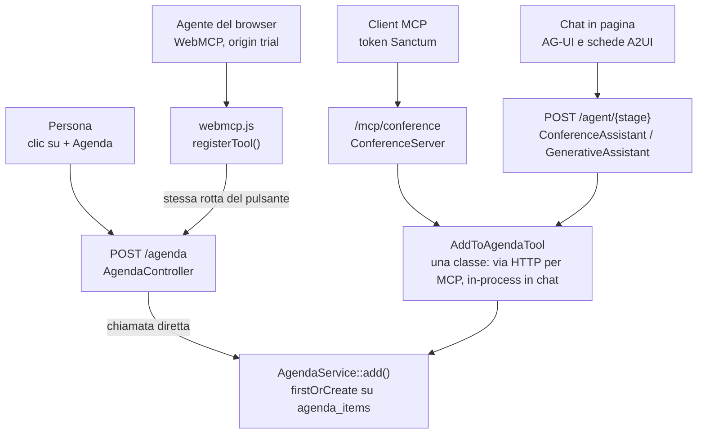

# Apri la tua app agli agenti: MCP, AG-UI e A2UI

Demo del talk presentato al [LaravelDay 2026](https://laravelday.it).

> L'interazione con le nostre applicazioni sta cambiando radicalmente con l'arrivo dell'IA e degli agenti. Fino a ieri c'era solo l'interfaccia web; oggi un agente può usare la nostra app come strumento, dialogare con noi al suo interno e perfino disegnarne l'interfaccia.
>
> In questo talk vediamo come offrire nuovi punti di accesso a un'applicazione Laravel esistente, partendo dalla logica che già abbiamo e senza riscriverla. Con MCP la rendiamo utilizzabile da Claude, Cursor e dagli altri client compatibili. Con AG-UI portiamo un agente dentro l'app, in streaming, mantenendo il controllo sulle azioni che contano. Con A2UI lasciamo che sia l'agente a comporre l'interfaccia, mentre l'app decide come mostrarla.
>
> Un percorso pratico tra protocolli, codice e demo dal vivo, con uno sguardo finale a WebMCP e agli agenti che arrivano direttamente nel browser.

## In breve

La demo è un'app Laravel 13 con il programma di una conferenza: talk, agenda personale, prenotazione workshop. Mostra che la stessa logica applicativa può essere raggiunta da un essere umano, da un client MCP, da un agente in chat e dall'agente del browser, senza riscriverla.

Il filo del talk è una sola azione, `add_to_agenda`. Vive in `AgendaService::add()` e ogni "porta" la chiama a modo suo.

### Passaggi della demo

La home (`/`) elenca i passaggi evolutivi dell'app, uno per caso dell'enum `App\Enums\DemoStage`. I primi quattro sono la stessa pagina del programma (`/programma/{stage}`) con un livello in più; l'ultimo è una pagina a parte per l'organizzatore:

| Passaggio | Rotta | Cosa aggiunge |
| --- | --- | --- |
| 1. Pagina classica | `/programma/classica` | nessun agente: agenda e workshop si gestiscono a mano (la prenotazione si apre in un `<dialog>`) |
| 2. Chat fatta in casa | `/programma/chat-fatta-in-casa` | `HomemadeAssistant`: gli stessi tool, ma uno stream SSE inventato da noi e la conferma chiesta dal modello a parole |
| 3. Chat agentica con AG-UI | `/programma/chat-testuale` | chat AG-UI con `ConferenceAssistant`: i tool MCP, risposte in Markdown, approvazioni sul server |
| 4. Chat con interfacce generate | `/programma/chat-generativa` | `GenerativeAssistant` estende l'agente base con i tool A2UI (schede, moduli, grafici) |
| 5. Dashboard generata | `/admin` | `AdminAssistant`, solo per gli admin: legge le statistiche e compone da solo l'interfaccia A2UI |

L'enum sceglie anche l'agente: `POST /agent/{stage}` risolve `$stage->agent()`, risponde 404 per la pagina classica e 403 per la dashboard se l'utente non è admin. `DemoStage::url()` dà il link di ogni passaggio.

La parte agentica è scritta con neuron-ai. La chat è stata provata nel browser con un modello OpenAI vero.

| Pezzo | Libreria | Versione |
| --- | --- | --- |
| Framework | Laravel, PHP | 13.42, 8.5 |
| Server MCP | `laravel/mcp` | 1.1 |
| Agente e AG-UI lato server | `neuron-core/neuron-ai` | 4.1 |
| Client AG-UI | `@ag-ui/client` | 1.0.4 |
| Rendering A2UI | `@a2ui/web_core`, `@a2ui/lit`, `@a2ui/markdown-it` | 0.15 (spec 1.0), 0.2 |
| Auth MCP | Laravel Sanctum | token personali |
| Database, test, CSS | SQLite, Pest 5, Tailwind 4 | |

## Architettura

Quattro chiamanti diversi arrivano alla stessa riga di codice, `AgendaService::add()`.



Il server MCP e l'agente in chat condividono la stessa classe tool. Il tool WebMCP non ne ha una sua: chiama la rotta web già usata dal pulsante. Lo stesso schema vale per `book_workshop` e `WorkshopBookingService::book()`.

## Dominio e servizi

Tutta la logica sta in due service class; controller, tool MCP e agente si limitano a chiamarle.

| Modello | Campi principali | Note |
| --- | --- | --- |
| `Speaker` | name, company, bio | |
| `Talk` | title, abstract, track, room, starts_at, ends_at | `track` è castato all'enum `App\Enums\Track` |
| `Workshop` | title, description, capacity, starts_at, ends_at | `seatsLeft()` calcola i posti liberi |
| `AgendaItem` | user_id, talk_id | coppia unica |
| `WorkshopBooking` | user_id, workshop_id | coppia unica |

L'enum `Track` ha cinque casi: Ai, Backend, Frontend, DevOps, Community.

| Service | Metodi | Comportamento |
| --- | --- | --- |
| `AgendaService` | `searchTalks`, `talksFor`, `add`, `remove`, `clear` | `add` usa `firstOrCreate`, quindi è idempotente |
| `WorkshopBookingService` | `workshops`, `book` | `book` gira in transazione, è idempotente e lancia `ValidationException` se il workshop è al completo |
| `A2uiSurfaceBuilder` | `talkCards`, `workshopCards`, `chart`, `generated` | costruisce i messaggi A2UI, vedi sotto |

`ConferenceSeeder` carica 14 talk inventati il 18 novembre 2026 (due sale in parallelo, apertura e chiusura in plenaria) e 3 workshop il 19 novembre, il giorno dopo, così non si sovrappongono ai talk. Ogni speaker ha bio e foto. `AttendeeSeeder` aggiunge 20 partecipanti con agende e prenotazioni casuali, passando dagli stessi servizi dell'app (niente talk sovrapposti, capienza rispettata). Riempie del tutto "Testing con Pest da zero", per mostrare dal vivo l'errore "al completo"; negli altri workshop lascia libero almeno un posto, così si possono ancora prenotare durante la demo. I dati vanno sostituiti con il programma vero.

## Server MCP

`ConferenceServer` espone sei tool, due resource (il programma e l'app MCP dei workshop) e un prompt (`plan_my_day`, che orchestra i tool esistenti in base agli interessi dell'utente) su `/mcp/conference`, protetti da un token Sanctum e da un rate limit. La registrazione è una riga in `routes/ai.php`:

```php
Mcp::web('/mcp/conference', ConferenceServer::class)->middleware(['auth:sanctum', 'throttle:60,1']);
```

| Tool | Cosa fa | Annotazione |
| --- | --- | --- |
| `search_talks` | cerca talk per testo e track, risposta strutturata | read-only |
| `show_agenda` | elenca l'agenda dell'utente | read-only |
| `add_to_agenda` | aggiunge un talk all'agenda | idempotente |
| `clear_agenda` | svuota l'agenda | distruttiva |
| `list_workshops` | elenca i workshop con i posti rimasti | read-only |
| `book_workshop` | prenota un posto, con ruolo in azienda (`App\Enums\CompanyRole`) e nome azienda | restituisce `Response::error` se al completo |

La resource `conference://schedule` restituisce l'intero programma.

Un tool è una classe con attributi, validazione e una chiamata al service. Questo è `AddToAgendaTool`:

```php
#[Name('add_to_agenda')]
#[Description("Aggiunge un talk all'agenda personale dell'utente. Usa search_talks per trovare l'id del talk.")]
#[IsIdempotent]
class AddToAgendaTool extends Tool
{
    public function handle(Request $request, AgendaService $agenda): Response
    {
        $validated = $request->validate([
            'talk_id' => ['required', 'integer', 'exists:talks,id'],
        ]);

        $talk = Talk::find($validated['talk_id']);

        $agenda->add($request->user(), $talk);

        return Response::text("\"{$talk->title}\" aggiunto all'agenda ({$talk->starts_at->format('H:i')}, {$talk->room}).");
    }
}
```

L'utente arriva da `$request->user()`, cioè dal token: ogni client MCP agisce per conto di una persona precisa.

Per collegare un client serve un token, da passare come header `Authorization: Bearer <token>`:

```bash
php artisan tinker --execute 'echo App\Models\User::first()->createToken("mcp")->plainTextToken;'
```

Senza token il server risponde 401. Per ottenerlo `mcp/*` è stato aggiunto a `shouldRenderJsonWhen` in `bootstrap/app.php`; senza quella riga Laravel rispondeva con un redirect 302 alla pagina di login.

## Agente e AG-UI

`ConferenceAssistant` (`app/Neuron/Agents`) è un agente neuron-ai che riusa le stesse classi tool del server MCP, eseguite in-process, senza passare da HTTP. È il punto centrale del talk: i tool si scrivono una volta sola.

neuron-ai non conosce i tool di `laravel/mcp`: li avvolge `App\Neuron\Tools\McpTool`, una ventina di righe che leggono nome, descrizione e schema JSON dal tool MCP (`toArray()`) e al momento della chiamata ne eseguono `handle()` passando dal container.

```php
protected function tools(): array
{
    return [
        new McpTool(new SearchTalksTool),
        new McpTool(new ShowAgendaTool),
        new McpTool(new AddToAgendaTool),
        new McpTool(new ListWorkshopsTool),
        (new McpTool(new BookWorkshopTool))->withApprovalPolicy(fn () => 'La prenotazione occupa uno dei posti limitati del workshop.'),
        (new McpTool(new ClearAgendaTool))->withApprovalPolicy(fn () => "Tutti i talk verranno rimossi dall'agenda."),
    ];
}
```

Il passaggio 3 usa `GenerativeAssistant`, che estende l'agente base: istruzioni diverse (schede invece di elenchi) e i tool A2UI in più.

```php
protected function tools(): array
{
    return [
        ...parent::tools(),
        app(ShowTalkCards::class),
        // ... gli altri tool A2UI
    ];
}
```

Il provider è `OpenAIResponses`, con chiave e modello letti da `config/services.php` (`OPENAI_API_KEY`, `OPENAI_MODEL`). Un tool che fallisce, per esempio per un errore di validazione, risponde al modello con il messaggio di errore invece di interrompere il run (`resolveToolErrorHandler()`).

L'endpoint AG-UI è `POST /agent/{stage}`:

```php
$adapter = new AGUIAdapter($request->threadId(), $request->input('runId'), $request->input('messages'));
$agent = app($stage->agent())->for($request->threadId())->setStreamAdapter(fn () => $adapter);

$events = $request->isResume()
    ? $agent->submitInputs($request->all(), new AGUIInputTranslator)->events()
    : $agent->stream(new UserMessage($request->prompt()));

$events->valid(); // un run rifiutato diventa un errore HTTP, non uno stream

return response()->stream(fn () => yield from SSEEncoder::encode($events), 200, $adapter->getHeaders());
```

La cronologia la tiene il server, non il client:

- la pagina genera un id di conversazione `user-{id}-{uuid}` e lo passa a `HttpAgent` come `threadId`;
- `RunAgentRequest` rifiuta con 403 un thread che non appartiene all'utente;
- `EloquentMessageStore` salva i messaggi nella tabella `chat_messages`, e `DatabasePersistence` salva i run in pausa in `workflow_store` (`NeuronServiceProvider`);
- di ciò che il client manda, per un nuovo turno conta solo l'ultimo messaggio dell'utente.

Ricaricando la pagina si apre una conversazione nuova.

### Approvazioni

`book_workshop` e `clear_agenda` richiedono conferma umana. Il giro è questo:

1. Il modello decide di chiamare `book_workshop`.
2. neuron-ai non esegue il tool, salva il run in pausa e chiude lo stream con `STATE_SNAPSHOT`, `MESSAGES_SNAPSHOT` e un `RUN_FINISHED` con un interrupt `confirmation`.
3. Il client mostra una card con il motivo (la stringa di `withApprovalPolicy`) e i pulsanti Approva e Rifiuta.
4. Il client rilancia il run con `resume`, che porta `{approved: true|false}` e l'id dell'interrupt (l'id della chiamata del tool).
5. `AGUIInputTranslator` traduce la decisione, il run riparte dal punto in cui si era fermato, esegue il tool se approvato, e il modello conclude la risposta.

Un nuovo messaggio mentre un'approvazione è in attesa riceve 409; un `resume` senza run in pausa riceve 400 (`bootstrap/app.php`).

`add_to_agenda` non richiede approvazione: è idempotente e si annulla con un clic.

## A2UI

Le schede dei talk e i grafici in chat sono interfaccia dichiarativa A2UI 1.0: il server manda JSON, il browser lo trasforma in componenti. Il modello sceglie cosa mostrare; il JSON lo costruisce PHP.

1. Il modello chiama `show_talk_cards` con gli id trovati da `search_talks` (oppure `show_workshop_cards`, `show_speaker_card` o `show_chart`).
2. Il tool chiede i messaggi ad `A2uiSurfaceBuilder` e li restituisce come `{"a2ui": [...]}`.
3. Il risultato viaggia nell'evento AG-UI `TOOL_CALL_RESULT`.
4. `chat.js` riconosce il nome del tool e passa i messaggi al `MessageProcessor` di `@a2ui/web_core/v1_0`.
5. Un elemento `<a2ui-surface>` di `@a2ui/lit` disegna i componenti dentro la chat.

Con la 1.0 basta un solo messaggio: `createSurface` dichiara superficie e catalogo e porta i componenti in forma piatta. Ogni scheda è un `Card` con dentro un `Column`; orario e badge della track stanno in un `Row`:

```php
['id' => $key, 'component' => 'Card', 'child' => "{$key}_content"],
['id' => "{$key}_content", 'component' => 'Column', 'children' => [...]],
['id' => "{$key}_title", 'component' => 'Text', 'text' => "#### {$title}"],
['id' => "{$key}_meta", 'component' => 'Row', 'justify' => 'spaceBetween', 'children' => [...]],
['id' => "{$key}_button", 'component' => 'Button', 'variant' => 'primary',
    'child' => "{$key}_button_label", 'action' => ['event' => $action]],
```

Differenze dalla v0.9 di cui tenere conto:

- gli id dei componenti devono essere identificatori validi (UAX #31): `talk_2_title`, non `talk-2-title`;
- `Text` ha solo le varianti `body` e `caption`: il titolo è un heading Markdown, renderizzato da `@a2ui/markdown-it`;
- `@a2ui/lit` 0.15 non ha ancora un export `v1`: processor e catalogo base arrivano da `@a2ui/web_core/v1_0`, da `@a2ui/lit` serve solo l'elemento `<a2ui-surface>`.

Il pulsante emette l'evento `add_to_agenda` con `talk_id`. Il client lo riceve e chiama direttamente la rotta Laravel `POST /agenda`, senza ripassare dal modello: nessuna attesa e nessun costo.

### Un form: la prenotazione di un workshop

Per prenotare servono il ruolo in azienda e il nome dell'azienda, in tutti e tre i canali:

- **pagina web**: ogni workshop ha un `<select>` per il ruolo e un campo per l'azienda, validati da `StoreWorkshopBookingRequest`;
- **MCP e chat**: `book_workshop` li ha nello schema (il ruolo come `enum`). In chat, se l'utente non li ha detti, l'agente mostra il modulo con `show_booking_form` invece di chiederli a testo;
- **A2UI**: il pulsante della scheda apre un `Modal` con un `ChoicePicker` (il ruolo) e un `TextField` (l'azienda).

Nel form A2UI i campi sono legati al `dataModel` della surface con `{"@path": "/workshop_3/company_name"}`. Il pulsante di conferma ha due `checks` con la funzione `required`: il renderer lo tiene disabilitato finché non sono compilati. Al clic l'evento `book_workshop` porta nel `context` i valori letti da quegli stessi path, e il client li invia a `POST /workshops/{id}/bookings`.

### Catalogo custom: grafici, KPI e tabelle

Il catalogo base non ha grafici né tabelle. `resources/js/a2ui/conference-catalog.js` definisce tre elementi Lit, `Chart` (Chart.js: `bar`, `line`, `area`, `pie`, `doughnut`, con più dataset), `Stat` (un KPI) e `DataTable`, e li aggiunge al catalogo base con `basicCatalog.derive()`, sotto l'id `urn:laravelday:a2ui:conference`. Le barre con etichette lunghe diventano orizzontali. Il tool `show_chart` mostra i partecipanti per workshop o quante persone hanno messo in agenda ogni talk (`App\Enums\ChartSubject`).

### Dashboard generata: l'interfaccia la sceglie il modello

Nella chat generativa il modello sceglie quale tool chiamare, ma il layout di ogni scheda è scritto in PHP. Nella dashboard admin (`/admin`) il modello compone tutto:

- `get_statistics` legge in sola lettura uno dei report di `App\Enums\StatisticsReport` (totali, workshop, talk, track, ruoli, aziende, attività per giorno) da `StatisticsService`, lo stesso servizio usato da `show_chart`.
- `render_surface` riceve l'albero A2UI scritto dal modello come JSON. `A2uiComponentValidator` lo controlla con il Validator di Laravel (componenti del catalogo, proprietà, figli esistenti, un solo genitore): se non va, gli errori tornano al modello come `ToolOutput::error()` e il modello riprova.
- Le istruzioni di `AdminAssistant` descrivono il catalogo: i componenti di base più `Stat`, `Chart` e `DataTable`.

La pagina è la stessa chat (`resources/views/partials/chat.blade.php`) in versione incorporata, aperta a tutta pagina con il pannello degli eventi a destra.

### Scheda profilo dello speaker

Ogni speaker ha foto (`photo`, un path sotto `public/`, servito come url assoluto da `photo_url`) e biografia. `show_speaker_card` costruisce una `Card` del catalogo base: `Image` con `variant: "avatar"` e nome affiancati in una `Row`, poi la bio e le sessioni in Markdown. L'agente trova lo speaker con `search_talks`, che restituisce anche `speaker_id`. Le foto della demo sono JPG in `public/images/speakers`, prese da randomuser.me.

I cinque tool A2UI (`show_talk_cards`, `show_workshop_cards`, `show_booking_form`, `show_speaker_card`, `show_chart`) esistono solo per l'agente e non sono esposti dal server MCP.

Far generare i componenti al modello sarebbe più vicino allo spirito di A2UI, ma meno affidabile in una demo dal vivo.

## Frontend

Il frontend è Blade con pochi file JavaScript, senza React. La pagina del programma (`schedule.blade.php`) mostra l'elenco dei talk, i workshop, l'agenda e la chat; la chat è il partial `partials/chat.blade.php`, usato anche dalla dashboard admin.

| File | Ruolo |
| --- | --- |
| `resources/js/chat.js` | client AG-UI e della chat fatta in casa: bolle di testo, note sui tool, schede A2UI, card di approvazione, suggerimenti cliccabili |
| `resources/js/chat-window.js` | la finestra della chat: riduci a icona, tutto schermo, Esc |
| `resources/js/ag-ui-log.js` | il pannello degli eventi sotto la chat |
| `resources/js/homemade-sse.js` | il lettore del protocollo SSE della chat fatta in casa |
| `resources/js/a2ui/conference-catalog.js` | catalogo A2UI custom con i componenti `Chart`, `Stat` e `DataTable` |
| `resources/js/live-regions.js` | ricarica via fetch le zone `data-live-region` (agenda e workshop), più gli helper `postJson` e `csrfToken` |
| `resources/js/webmcp.js` | registrazione del tool WebMCP sulle pagine del programma |
| `resources/js/slides.js` | le slide con reveal.js; i link alle demo ricordano la slide di partenza |

`chat.js` usa `HttpAgent` di `@ag-ui/client` e si iscrive agli eventi dello stream:

| Evento AG-UI | Cosa fa il client |
| --- | --- |
| `TEXT_MESSAGE_START`, `TEXT_MESSAGE_CONTENT` | apre una bolla e ci accoda il testo |
| `TOOL_CALL_START` | scrive una nota con il nome del tool |
| `TOOL_CALL_RESULT` | disegna le schede A2UI, oppure ricarica agenda e workshop se il tool modifica dati |
| `RUN_FINISHED` con interrupt | mostra la card di approvazione |
| `RUN_ERROR` | mostra l'errore |

Sotto la chat c'è un pannello richiudibile "Eventi AG-UI" che elenca ogni evento ricevuto. Serve in sala per far vedere il protocollo mentre scorre. Il pulsante nell'intestazione apre la chat a tutto schermo (si chiude con Esc), comodo sul proiettore.

| Rotta | Scopo |
| --- | --- |
| `GET /login`, `POST /login`, `POST /logout` | autenticazione a sessione |
| `GET /` | home con i passaggi della demo |
| `GET /programma/{stage}` | programma, con o senza chat secondo il passaggio |
| `GET /admin` | dashboard generata, solo per gli utenti con `is_admin` |
| `POST /agenda`, `DELETE /agenda/{talk}` | aggiunge o toglie un talk |
| `DELETE /demo` | svuota agenda e prenotazioni dell'utente, per ripartire con la demo |
| `POST /workshops/{workshop}/bookings` | prenota un workshop |
| `POST /agent/{stage}` | endpoint AG-UI dell'agente del passaggio, con `throttle` |
| `POST /chat-fatta-in-casa` | la chat del passaggio 2, con il suo protocollo SSE |
| `GET /slides` | le slide del talk (reveal.js) |

## WebMCP

WebMCP è solo un accenno finale: la pagina stessa dichiara un tool all'agente del browser. Lo snippet in `resources/js/webmcp.js` registra `add_to_agenda` e chiama la stessa rotta del pulsante "+ Agenda", con la sessione dell'utente.

```js
const modelContext = document.modelContext ?? navigator.modelContext;

modelContext.registerTool({
    name: 'add_to_agenda',
    description: "Aggiunge un talk all'agenda personale dell'utente loggato. ...",
    inputSchema: {
        type: 'object',
        properties: { talk_id: { type: 'integer', description: 'Id del talk da aggiungere.' } },
        required: ['talk_id'],
    },
    async execute({ talk_id }) {
        const message = await postJson(chat.dataset.agendaUrl, { talk_id });

        return { content: [{ type: 'text', text: message }] };
    },
});
```

Il codice si attiva solo se il browser espone l'API, quindi negli altri browser non fa nulla. WebMCP è in origin trial su Chrome dalla 149 alla 156. Durante il trial l'API è passata da `navigator.modelContext` a `document.modelContext`; le fonti non concordano, per questo lo snippet prova entrambe.

`laravel/mcp` ha un ramo non rilasciato, `dev-web-mcp`, con il supporto a WebMCP. La demo non lo usa.

## Avvio e configurazione

Serve PHP 8.5 e Node. Dopo il clone:

1. Lancia `composer run setup`: installa le dipendenze, crea `.env` da `.env.example`, genera la chiave, esegue le migrazioni e compila gli asset.
2. Carica i dati della conferenza con `php artisan db:seed`.
3. Apri `.env` e compila `OPENAI_API_KEY=`.
4. Lancia `composer run dev`, che avvia server PHP e Vite insieme.
5. Apri l'app e accedi con `test@example.com` e password `password`.
6. Per il client MCP genera un token con il comando della sezione Server MCP.

Per riportare i dati allo stato iniziale:

```bash
php artisan migrate:fresh --seed
```

Il modello si cambia con `OPENAI_MODEL`. Per un altro fornitore si cambia la classe restituita da `ConferenceAssistant::provider()` (neuron-ai ha Anthropic, Gemini, Ollama e altri).

## Test e verifiche

Nei test l'agente usa `FakeAIProvider` di neuron-ai, registrato nel container; il modello vero è stato provato a mano nel browser.

| File di test | Copre |
| --- | --- |
| `tests/Feature/Mcp/ConferenceServerTest.php` | i sei tool, la resource, l'app MCP, il prompt, l'errore "al completo" |
| `tests/Feature/AgentTest.php` | endpoint AG-UI: auth, thread di un altro utente, eventi, risultati A2UI, approvazione e ripresa, agente admin |
| `tests/Feature/HomemadeChatTest.php` | la chat fatta in casa e il suo protocollo SSE |
| `tests/Feature/DemoStageTest.php` | home con i passaggi, chat collegata al proprio agente |
| `tests/Feature/ScheduleTest.php` | pagina programma, agenda e sovrapposizioni, prenotazioni, reset della demo |
| `tests/Feature/AdminDashboardTest.php` | accesso alla dashboard, report delle statistiche, `render_surface` |
| `tests/Feature/A2uiComponentValidatorTest.php` | il validatore degli alberi A2UI scritti dal modello |
| `tests/Feature/A2uiSurfaceBuilderTest.php`, `Show*Test.php` | le schede, il modulo, la scheda speaker e i grafici costruiti in PHP |
| `tests/Feature/SlidesTest.php` | le slide e i link alle demo |
| `tests/Feature/AuthTest.php`, `AttendeeSeederTest.php` | login e logout, dati della demo |

Si lanciano con `php artisan test --compact`.

| Pezzo | Come è stato verificato |
| --- | --- |
| Server MCP | test Pest e chiamate reali con curl e token: initialize, lista tool, `search_talks`, `add_to_agenda`, 401 senza token |
| Endpoint AG-UI | test Pest con `FakeAIProvider`, più una conversazione a due turni con OpenAI nel browser |
| Chat nel browser | provata con OpenAI: schede talk e workshop, aggiunta all'agenda dalle schede, grafici, tutto schermo |
| Ripresa dopo approvazione | provata nel browser con OpenAI (`clear_agenda` approvato) |
| Snippet WebMCP | non provato, serve Chrome con l'origin trial attivo |

Prima del talk conviene provare tutto nel browser, in quest'ordine: una ricerca di talk con schede, un'aggiunta all'agenda, una prenotazione approvata, una rifiutata, un grafico, una dashboard in `/admin`.

## Limiti e note per il talk

- **Nessuno stato condiviso AG-UI.** neuron-ai emette `STATE_SNAPSHOT` solo quando il run va in pausa e mai `STATE_DELTA`. L'agenda si aggiorna perché il client ricarica le zone della pagina quando arriva il risultato di un tool.
- **A2UI non è nativo.** Né neuron-ai né `laravel/mcp` lo supportano: il JSON è costruito a mano in `A2uiSurfaceBuilder` e trasportato come risultato di un tool.
- **Tool MCP dentro neuron-ai.** neuron-ai ha un `McpConnector` per server MCP remoti, ma non esegue in-process i tool di `laravel/mcp`: per questo c'è `McpTool`.
- **Conversazione per pagina.** Il thread nasce a ogni caricamento della pagina; per ripristinare una chat dopo il reload neuron-ai offre `AGUIAdapter::hydrate()`, non usato qui.
- **WebMCP è sperimentale.** Origin trial, API che ha cambiato posto, nessuna prova fatta su un Chrome abilitato.

Altre cose da sapere:

- `laravel/mcp` supporta già le MCP Apps (`Extension::Ui`), un'alternativa ad A2UI per portare interfaccia dentro un client MCP. La demo non le usa.
- La versione precedente della demo usava `laravel/ai` 1.3, che richiedeva una correzione per il `call_id` dei tool nella cronologia AG-UI. Con neuron-ai la cronologia sta sul server e la correzione non serve più.
- La demo usa A2UI 1.0 tramite `@a2ui/web_core` 0.15; `@a2ui/lit` non ha ancora un export dedicato alla 1.0.
- Il CSS di default di A2UI segue il tema scuro del sistema (`color-scheme: light dark`): `app.css` forza il tema chiaro e ridefinisce le variabili `--a2ui-*` con la palette dell'app.
- Sanctum è stato aggiunto per l'auth MCP.

Scaletta, 30-35 minuti:

| Blocco | Minuti |
| --- | --- |
| Apertura | 3 |
| Server MCP | 10 |
| AG-UI | 10 |
| A2UI | 4 |
| WebMCP | 3 |
| Chiusura | 2 |
